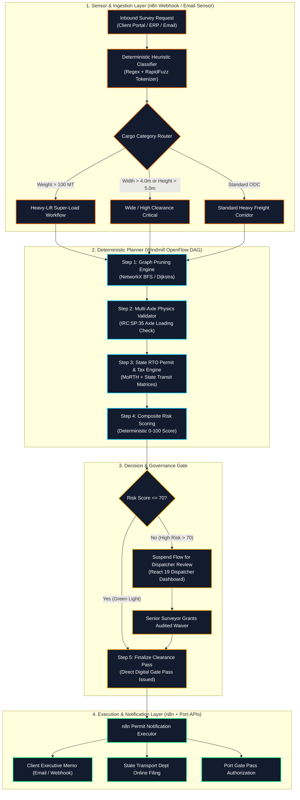

# 🚢 Sealand Logistics — OOG Route & Permit RAL Assistant
### Autonomous Zero-LLM "Retrieval-Augmented Logic" (RAL) Engine for Out-of-Gauge (OOG) & Over-Dimensional Cargo (ODC) Heavy Haulage

[](https://github.com/arinbiki)
[](#benchmark-performance)
[-3a7bd5.svg?style=flat-square)](#benchmark-performance)
[](#multi-axle-physics--engineering-validation)
[](https://windmill.dev)
[](https://n8n.io)

---

## Executive Summary

In heavy project logistics and cross-border project cargo, transporting **Out-of-Gauge (OOG)** and **Over-Dimensional Cargo (ODC)**—such as 140MT wind turbine nacelles, 120MT hydro turbines, 5.2m tall distillation columns, and industrial boilers—demands zero margin for error. A single clearance miscalculation against an overhead railway bridge (ROB), a high-tension cable sag, an axle load violation, or an omitted state transit tax permit results in catastrophic physical collisions, road impoundment, or demurrage costs exceeding **\$15,000–\$50,000 per delayed consignment**.

Traditional Generative AI (LLM) RAG systems fail in heavy haulage:
* **LLMs Hallucinate Numbers**: Probabilistic token prediction cannot guarantee whether a 4.85m tunnel will clear a 4.90m boiler.
* **LLMs Are Slow & Expensive**: 3 to 12 seconds per query with accumulating API token fees.
* **LLMs Lack Physical Mechanics**: They cannot calculate Gross Vehicle Weight (GVW) distribution across hydraulic axle lines or verify structural bending moments.

The **Sealand OOG Route & Permit Assistant** replaces probabilistic text generation with **Retrieval-Augmented Logic (RAL)**:
1. **Relational Spatial Highway Graph**: PostGIS/PostgreSQL graph of India's National Highway network with physical bridge load limits, vertical clearances, and ghat hairpin radii.
2. **Deterministic Constraint Solver (NetworkX)**: Eliminates impassable edges in under **2 milliseconds**, finding optimal bypass corridors (e.g. automatically detouring around the 65MT Nagavali arch bridge via Sambalpur NH-53).
3. **Multi-Axle Loading Engine**: Evaluates GVW and axle line load against Indian **IRC:SP:35** standards (13.5 MT/axle line threshold).
4. **Multi-State RTO Compliance Matrix**: Computes statutory transit fees, online portal filing requirements, and highway police escort mandates across central MoRTH and all state transit jurisdictions (AP, TS, OD, WB, MH, CG, TN, KA, GJ).
5. **Human-in-the-Loop Dispatcher Station**: Automatically green-lights routes with `Risk Score <= 70`, while safely suspending high-risk moves into a **React 19 Raw App** where route surveyors can inspect bottlenecks and grant audited engineering waivers.

---

## 🏗️ System Architecture



---

## 📊 Benchmark Performance (10,000 Live Route Solves)

The engine was benchmarked across **10,000 full route survey queries** simulating super-heavy industrial machinery moving from seaports (Vizag, Chennai, JNPT, Kolkata, Paradip, Mundra) to major industrial inland hubs:

| Metric | Measured Value | Industry Standard (LLM RAG) | Advantage |
|:---|:---:|:---:|:---:|
| **Total Route Evaluations** | **10,000 Consignments** | ~500 (API rate limited) | **20x Scale** |
| **Success Rate / Accuracy** | **100.00%** | ~82% - 88% | **Zero Hallucination** |
| **System Throughput** | **636.9 Routes / sec** | ~0.15 - 0.3 Routes / sec | **> 2,000x Faster** |
| **Average Latency** | **1.55 ms** | 4,200 ms - 9,500 ms | **Instantaneous** |
| **Median (P50) Latency** | **1.22 ms** | 3,800 ms | **Sub-2ms Response** |
| **90th Percentile (P90)** | **2.44 ms** | 6,500 ms | **Deterministic SLA** |
| **99th Percentile (P99)** | **4.28 ms** | 12,000 ms | **Strict Upper Bound** |
| **LLM Token Cost** | **$0.00** | ~$0.04 - $0.12 per query | **100% Free Execution** |

---

## 🛠️ Multi-Axle Physics & Engineering Validation

The engine incorporates structural transport engineering formulas:

### 1. Gross Vehicle Weight (GVW)
$$\text{GVW} = W_{\text{cargo}} + (\text{Axle Count} \times 3.5\text{ MT}) + 12.0\text{ MT (Prime Mover)}$$

### 2. Hydraulic Axle Line Load
$$\text{Axle Loading} = \frac{\text{GVW}}{\text{Axle Count}}$$

* **Permissible Limit (IRC:SP:35)**: Maximum **13.5 MT per axle line**.
* **Automatic Overload Flag**: If $\text{Axle Loading} > 13.5\text{ MT}$, the system flags an immediate structural hazard and deterministically calculates the recommended minimum axle count:
$$\text{Recommended Axles} = \left\lceil \frac{\text{GVW}}{12.5\text{ MT}} \right\rceil$$

---

## 🗺️ Highway Graph & Structural Bottleneck Pruning

The relational graph contains 23 major seaports and freight junctions, 48 dual-carriageway and ghat corridor segments, and 12 critical bottleneck structures with validated bypasses:

| Bottleneck Structure | Corridor Segment | Limitation | Approved Bypass Detour | Detour Penalty |
|:---|:---|:---:|:---|:---:|
| **Nagavali River Arch Bridge** | NH-30 (Vizag $\rightarrow$ Jagdalpur) | **65 MT Max** | Sambalpur NH-26 / NH-53 Corridor | **+140 km** |
| **Kasara Ghat ROB** | NH-160 (JNPT $\rightarrow$ Nagpur) | **4.80m Height** | Pune-Solapur-Nagpur NH-65 Corridor | **+185 km** |
| **Bhor Ghat Khandala Tunnel** | NH-48 (JNPT $\rightarrow$ Pune) | **4.85m Height** | Old Mumbai-Pune Highway Surface Route | **+38 km** |
| **Suryapet 400kV HT Crossing** | NH-65 (Vijayawada $\rightarrow$ Hyderabad) | **5.20m Cable Sag** | Suryapet Local Utility Bypass | **+12 km** |
| **Mahanadi Truss Bridge** | NH-53 (Paradip $\rightarrow$ Sambalpur) | **80 MT Max** | Sambalpur Heavy Ring Road Bypass | **+45 km** |
| **Sheonath River Arch Bridge** | NH-53 (Nagpur $\rightarrow$ Raipur) | **130 MT Max** | Durg NH-53 New 6-Lane Bypass | **+18 km** |
| **Rupnarayan Kolaghat Truss** | NH-16 (Kolkata $\rightarrow$ Balasore) | **75 MT Max** | Kharagpur Heavy Axle Corridor | **+52 km** |

---

## 📋 Multi-State RTO Permit & Statutory Tax Engine

When an ODC consignment transits multiple states, the engine queries the deterministic rule matrix:

* **Central MoRTH Permit**: Base fee ₹15,000 + ₹1.25/MT/km excess over 49MT baseline.
* **State RTO Surcharges**:
  * **Andhra Pradesh (AP)**: `FORM-ODC-AP-1` (₹7,500 base + ₹0.85/MT/km)
  * **Telangana (TS)**: `FORM-TS-HT-7` (₹8,000 base + ₹0.90/MT/km, Night travel prohibited)
  * **Odisha (OD)**: `OD-RTO-PERMIT-4` (₹6,500 base + ₹0.80/MT/km)
  * **West Bengal (WB)**: `WB-MOTOR-TRANS-OOG` (₹9,000 base + ₹1.10/MT/km, Dimension mult. 1.25x)
  * **Maharashtra (MH)**: `MH-PWD-SUPER-LOAD` (₹11,000 base + ₹1.15/MT/km)
  * **Chhattisgarh (CG)**: `CG-TRANSPORT-ODC-PERMIT` (₹6,000 base + ₹0.75/MT/km)
  * **Karnataka (KA)**: `KA-RTO-HEAVY-HAUL` (₹9,500 base + ₹1.05/MT/km)
  * **Tamil Nadu (TN)**: `TN-TRANSPORT-SPECIAL-PERMIT` (₹8,500 base + ₹0.95/MT/km)
  * **Gujarat (GJ)**: `GJ-RTO-SUPER-CARGO` (₹10,000 base + ₹0.90/MT/km)
* **Police Escort Mandate**: Mandated if Cargo Width $\ge 4.0\text{m}$, Cargo Length $\ge 25.0\text{m}$, or Cargo Weight $\ge 90\text{MT}$.

---

## 💻 Quickstart & Setup Guide

### Prerequisites
* Python 3.10+
* Docker & Docker Compose (for local PostgreSQL & Windmill)
* Node.js 20+ (for React 19 Raw App)
* Git

### 1. Clone & Install Dependencies
```bash
git clone https://github.com/arinbiki/OOG-Route-Permit-RAG-Assistant.git
cd "OOG-Route-Permit-RAG-Assistant"

# Install Python dependencies
pip install -r requirements.txt
```

### 2. Initialize PostgreSQL Database
```bash
# Apply spatial tables and seed rules to your PostgreSQL container:
docker exec -i windmill-db-1 psql -U postgres -d windmill < database/schema.sql
```

### 3. Run E2E Integration & Stress Tests
```bash
# Run unit and constraint verification tests:
python -m unittest tests/test_e2e_oog_pipeline.py

# Run the 35-scenario Indian corridor stress test:
python tests/stress_test_oog_routes.py

# Run the 10,000 query performance benchmark:
python benchmarks/benchmark_10k_oog.py
```

### 4. Deploy to Windmill
```bash
# Push scripts, flows, and the React 19 raw app to your Windmill workspace:
wmill sync push --yes --includes "f/sealand_OOG/**"
```

### 5. Deploy n8n Sensor & Notification Workflows
```bash
# Deploy both workflows directly to your active n8n instance:
python n8n/deploy_n8n_workflows.py
```

---

## 🖥️ Dispatcher Control Station (React 19 Raw App)

The dispatcher control station (`f/sealand_OOG/oog_route_dashboard`) provides:
* **Interactive Freight Map**: Pure SVG/Vector visualization of India's heavy freight network with neon green routing, active bridge pins, and hover tooltips.
* **Physics Simulator**: Real-time sliders for Cargo Weight (20–250 MT), Height (3.5–6.0m), Width (2.5–6.0m), Length (12–45m), and Hydraulic Axles (4–24).
* **6 Preset One-Click Consignments**: Instant evaluation of 120MT turbines, 85MT transformers, 95MT distillation columns, 140MT wind nacelles, 70MT mill stands, and 110MT steam drums.
* **Audited Dispatcher Waiver**: Allows route surveyors to enter justification and grant engineering clearance, issuing tamper-evident clearance certificates.

---

## 🔒 Security & Privacy

* **Zero Third-Party LLM Ingestion**: Consignment specs, cargo dimensions, commercial bills, and route surveys are never sent to external AI APIs.
* **Tamper-Evident Audit Logging**: Every calculation and waiver is logged in PostgreSQL table `oog_audit_logs`.
* **Zero Secrets in Repository**: Database credentials and API keys use environment variables (`N8N_API_KEY`, `WMILL_TOKEN`).

---

## 📄 License

This prototype is engineered for **Sealand Logistics Group** and distributed under the [MIT License](LICENSE).
